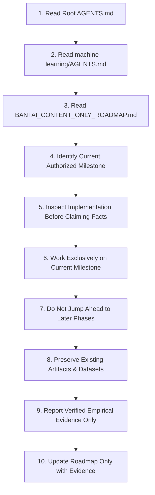
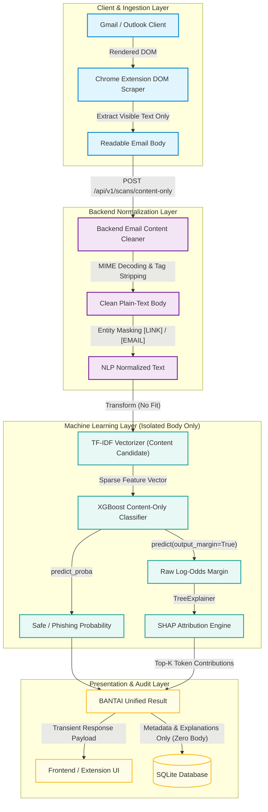
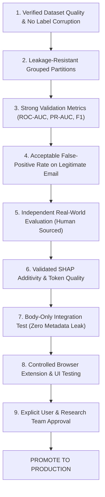

# BANTAI — Content-Only Email Phishing Detection Roadmap

**Document Title:** BANTAI Content-Only Email Phishing Detection Roadmap and Technical Specification  
**Formal Research Title:** *XGBoost-Based Email Threat Detection and Analysis Engine using Explainability Framework*  
**Research Methodology:** Hybrid Agile Scrum & CRISP-DM (Cross-Industry Standard Process for Data Mining)  
**Document Status:** Authoritative Development Roadmap and Engineering Specification  
**Current Active Milestone:** **Phase 10 — System Testing, Reliability, Privacy, and Acceptance Verification (COMPLETED & VERIFIED); Phase 11 Thesis, Research Synthesis, and Academic Defense Preparation Pending Review and Explicit Authorization**  
**Target Development Branch:** `feature/content-only-nlp` *(User-managed branch isolation)*  
**Last Updated:** November 2026  

---

## Table of Contents

1. [Section 1 — Mission and Strategic Reset](#section-1--mission-and-strategic-reset)
2. [Section 2 — Authoritative AI-Agent Workflow Rules](#section-2--authoritative-ai-agent-workflow-rules)
3. [Section 3 — Current Project Status and Baseline State](#section-3--current-project-status-and-baseline-state)
4. [Section 4 — Primary Research Objective and Detection Philosophy](#section-4--primary-research-objective-and-detection-philosophy)
5. [Section 5 — New Content-Only Architecture and Pipeline](#section-5--new-content-only-architecture-and-pipeline)
6. [Section 6 — Email Ingestion, MIME Decoding, and Content Extraction Specification](#section-6--email-ingestion-mime-decoding-and-content-extraction-specification)
7. [Section 7 — Initial Development Dataset and Training Strategy](#section-7--initial-development-dataset-and-training-strategy)
8. [Section 8 — Explicit Out-of-Scope Architecture Elements](#section-8--explicit-out-of-scope-architecture-elements)
9. [Section 9 — Historical Research and Artifact Preservation Registry](#section-9--historical-research-and-artifact-preservation-registry)
10. [Section 10 — Model Evaluation, Validation, and Promotion Policy](#section-10--model-evaluation-validation-and-promotion-policy)
11. [Section 11 — Comprehensive 12-Phase Development Roadmap](#section-11--comprehensive-12-phase-development-roadmap)
    - [Phase 0 — Project and Branch Isolation](#phase-0--project-and-branch-isolation)
    - [Phase 1 — Dataset Discovery and Inspection (ACTIVE)](#phase-1--dataset-discovery-and-inspection-active)
    - [Phase 2 — Dataset Quality, Leakage Prevention, and Partitioning](#phase-2--dataset-quality-leakage-prevention-and-partitioning)
    - [Phase 3 — Content-Only Email Cleaning and Extraction Engine](#phase-3--content-only-email-cleaning-and-extraction-engine)
    - [Phase 4 — New NLP Candidate Model Development](#phase-4--new-nlp-candidate-model-development)
    - [Phase 5 — Validation, Error Analysis, and False-Positive Diagnostics](#phase-5--validation-error-analysis-and-false-positive-diagnostics)
    - [Phase 6 — SHAP Explainability Framework and Token Contribution Verification (COMPLETED & VERIFIED)](#phase-6--shap-explainability-framework-and-token-analysis-completed--verified)
    - [Phase 7 — Model Packaging and Inference Contract Implementation (COMPLETED & VERIFIED)](#phase-7--model-packaging-and-inference-contract-implementation-completed--verified)
    - [Phase 8 — Content-Only Backend Integration and Dual-Path Pipeline (COMPLETED & VERIFIED)](#phase-8--content-only-backend-integration-and-dual-path-pipeline-completed--verified)
    - [Phase 9 — Chrome Extension Content-Only Integration (COMPLETED & VERIFIED)](#phase-9--chrome-extension-content-only-integration-completed--verified)
    - [Phase 10 — End-to-End Privacy, Reliability, and Acceptance Testing (COMPLETED & VERIFIED)](#phase-10--end-to-end-privacy-reliability-and-acceptance-testing-completed--verified)
    - [Phase 11 — Thesis, Research Synthesis, and Academic Defense Preparation](#phase-11--thesis-research-synthesis-and-academic-defense-preparation)
12. [Section 12 — Resource Management and Hardware Constraints](#section-12--resource-management-and-hardware-constraints)

---

## Section 1 — Mission and Strategic Reset

BANTAI is resetting its development roadmap and primary machine learning research direction.

### 1.1 The Core Strategic Shift

The primary objective of BANTAI is now to develop a reliable **Content-Only Email Phishing Detection System**. 

The system prioritizes the **actual readable content and semantic intent of emails** over auxiliary artifacts such as URL structures, HTML/CSS formatting tricks, transport headers, MIME boundaries, or sender network metadata. 

In traditional heuristic and multi-modal email filters, attackers frequently bypass defenses by embedding malicious links inside reputable services (e.g., Google Docs, SharePoint, Firebase, Canva), manipulating link redirect chains, or forging legitimate-looking headers. Conversely, legitimate operational emails—such as internal corporate announcements, automated password resets, system alerts, newsletters, and marketing promotions—frequently contain complex URL structures, tracking parameters, or unauthenticated relay headers that trigger false positives in structural classifiers.

By centering detection on natural language semantics and body intent, BANTAI aims to detect the deceptive, coercive, or fraudulent messaging core to social engineering attacks regardless of the delivery mechanism.

> [!IMPORTANT]
> **Preservation of Prior Work:** This roadmap is a strategic reset of current engineering priorities and research sequencing. It is **not** an instruction to delete prior research, discard existing model artifacts, wipe Benchmark datasets, or rewrite the existing production dual-engine pipeline. All prior work is preserved as baseline and comparative evidence.

---

## Section 2 — Authoritative AI-Agent Workflow Rules

This document (`BANTAI_CONTENT_ONLY_ROADMAP.md`) is the **authoritative source of truth** for all future BANTAI development, experiments, testing, and integration. It supersedes previous conversational summaries and planning notes.

For every future engineering task, an AI coding agent or collaborator **must strictly adhere to the following 10-step protocol**:



### The 10 Mandatory Agent Rules:

1. **Read Root Instructions First:** Read `AGENTS.md` before taking any action.
2. **Read ML Domain Instructions:** Read `machine-learning/AGENTS.md` whenever machine learning, preprocessing, training, or evaluation is involved.
3. **Consult the Active Roadmap:** Read `BANTAI_CONTENT_ONLY_ROADMAP.md` to ground current objectives and architectural constraints.
4. **Identify Active Milestone:** Pinpoint the exact active phase and review its specific tasks and completion gate.
5. **Inspect Reality First:** Inspect actual source files, dataset schemas, and artifacts rather than assuming their existence or state.
6. **Strict Milestone Containment:** Execute only the work scoped for the active milestone.
7. **No Premature Advancement:** Never jump ahead to future phases (e.g., do not integrate into the backend before training and evaluation are complete).
8. **Preserve Historical Artifacts:** Never overwrite baseline models, Zenodo models, URL models, or historical benchmark datasets.
9. **Research Integrity:** Report only actual empirical results. Never fabricate metrics, row counts, confusion matrices, or SHAP findings.
10. **Evidence-Based Progress:** Advance milestone status only when the completion gate has been fully satisfied and independently verified.

> [!NOTE]
> This roadmap governs project execution order. It does not supersede root `AGENTS.md`, statutory privacy requirements, or actual working code.

---

## Section 3 — Current Project Status and Baseline State

To ensure total transparency and prevent inaccurate assumptions, the project baseline at the time of establishing this roadmap is formally recorded:

| Component / Subsystem | Current Status | Notes & References |
| :--- | :--- | :--- |
| **Phase 1 ML Research (Baseline)** | **Completed & Preserved** | Kaggle 50k baseline (`machine-learning/artifacts/baseline/`) and Zenodo MeAJOR optimized model (`artifacts/zenodo_optimized/`). |
| **Phase 2 Benchmark V3 Research** | **Partially Completed & Preserved** | Cohort C1 acquisition pilot completed; ground truth taxonomy frozen; pending final multi-cohort collection. Isolated from content-only track. |
| **Phase 3 Dual-Engine Integration** | **Completed & Retained** | Max-threat aggregation between Zenodo NLP and URL Model v2 (`artifacts/url_model_v2/`) preserved as the fallback production pipeline. |
| **New Content-Only Direction** | **Approved & Active** | Formal pivot to body-text linguistic classification. |
| **Phase 2 Independent Threat Corpora** | **Completed & Preserved** | Controlled acquisition of Phishing Pot (2,000 `.eml`) and Nigerian Fraud (Zenodo 8339691). |
| **Phase 3 Cleaning & Extraction Engine** | **Completed & Accepted** | Hardened HTML/MIME parser with zero URL/email leakage and visible anchor preservation. |
| **Phase 4.1.3 Preprocessing Remediation & Parser Recovery** | **Completed & Verified** | Restored authentic visible monkey.org prose (200 records flagged); recovered all 5 malformed Phishing Pot messages (1,961/2,000 recovered, 98.05%; 39 verified non-textual); zero style/applet hazard leakage; 43/43 unit tests passing. |
| **Candidate V1 Corpus & Baseline** | **Completed & Preserved** | 37,350 records (3,509 Phish / 33,841 Ham); historical baseline evaluated in Phase 4.5.1; preserved untouched. |
| **Candidate V2 Corpus & Non-Modeling Collections** | **Constructed & Sealed** | 35,522 records (1,681 Phish / 33,841 Ham; 20.13:1 imbalance); 6 auxiliary non-modeling collections (1,828 records); 100% Phishing Pot accounted for. |
| **Candidate V2 Partitions** | **Generated & Sealed** | 5-fold StratifiedGroupKFold (seed=42) + Bidirectional Source-Transfer (Split A & B); strictly 0 group leakage; 79/79 unit & regression tests passing. |
| **Content-Only Candidate V2 Models** | **Trained & Evaluated (Phase 4.6)** | Six controlled TF-IDF experiments (EXP-0 to EXP-5); EXP-4 (25k, min_df=5) top in-domain (F1: 0.9248, Recall: 87.75%, FPR: 0.10%); Split B zero-shot modern recall: 31.5%–33.9% (FPR: 0.12%); 86/86 regression tests passing. |
| **Content-Only Backend Ingestion** | **Completed & Verified (Phase 8)** | Dedicated `POST /api/v1/scans/content-only` route with zero-body privacy, atomic lifespan pre-warming, degraded startup isolation, and idempotent candidate registration. |
| **Content-Only Chrome Extension** | **Completed & Verified (Phase 9)** | Extension extracts Gmail visible body prose, calls `POST /api/v1/scans/content-only` with standard auth, displays model classification, continuous probability, and SHAP token polarity. |
| **Real-World Model Performance** | **Partially Profiled (Tier 2 Transfer)** | Diagnostic source-transfer evaluated; independent validation and Phase 5 diagnostics pending authorization. |
| **Active Development Milestone** | **Phase 9 Extension and Frontend Integration Completed & Verified; Phase 10 Reliability Testing Pending Authorization** | Extension DOM extractor, popup controller, frontend client, and past scan visualization verified; 29 frontend tests passing; 10 backend content tests passing; 10 packaged ML tests passing; 394 backend tests passing. |
| **Target Git Development Branch** | `feature/content-only-nlp` | Branch creation and checkout is a user-managed step. Do not assume or assert git branch state automatically. |

---

## Section 4 — Primary Research Objective and Detection Philosophy

### 4.1 Objective Statement

> **Primary Objective:** Develop a content-focused NLP email phishing detector that analyzes strictly the clean, readable body text of an email to identify linguistic indicators of phishing, social engineering, and fraudulent intent.

The system is designed to understand the *language*, *psychological triggers*, and *communicative goals* of an email, rather than relying on technical transport metadata, domain registration ages, or URL structural characteristics.

### 4.2 Semantic and Linguistic Phishing Indicators

The content-only model will be trained to recognize common linguistic strategies leveraged in social engineering attacks, including but not limited to:

```text
       ┌─────────────────────────────────────────────────────────┐
       │             Linguistic Phishing Indicators              │
       └─────────────────────────────────────────────────────────┘
                                    │
    ┌────────────────┬──────────────┴──────────────┬────────────────┐
    ▼                ▼                             ▼                ▼
Urgency & Threat  Credential Harvesting       Impersonation     Deceptive Offers
----------------  ---------------------       -------------     ----------------
• Account locked  • "Verify your password"    • IT Support      • Prize winner
• Legal action    • "Confirm banking PIN"     • Executive / HR  • Fake invoice refund
• 24-hour expiry  • MFA token requests        • Tax authority   • Cryptocurrency grant
• Immediate loss  • Re-authenticate identity  • Vendor spoofing • Unsolicited inheritance
```

1. **Urgent and Threatening Language:** Psychological coercion inducing fear, panic, or hasty action (e.g., *"Your account will be terminated within 24 hours"*).
2. **Credential and Secret Harvesting:** Direct or indirect solicitations for credentials, passwords, two-factor codes, PINs, or confidential corporate data.
3. **Identity and Security Verification Lures:** Prompts instructing users to *"update your billing information"*, *"re-validate your security questions"*, or *"unlock your mailbox"*.
4. **Threats of Account or Service Suspension:** Coercive statements asserting suspension of email, payroll, cloud storage, banking, or enterprise software access.
5. **Artificial Deadlines and Temporal Pressure:** Explicit time-box constraints forcing the victim to bypass standard verification protocols.
6. **Deceptive and Contradictory Instructions:** Guidance asking the user to ignore security warnings, download untrusted attachments, or contact non-standard numbers.
7. **Body Impersonation Signals:** Linguistic framing mimicking corporate IT departments, payroll officers, bank fraud divisions, or executive leadership.
8. **Generic Greetings in High-Stakes Contexts:** Vague openings (*"Dear Customer"*, *"Valued User"*) paired with urgent account-specific claims.
9. **Fraudulent Offers and Unrealistic Inducements:** Unsolicited lottery winnings, unexpected tax refunds, exaggerated vendor discounts, or anomalous payment notifications.

> [!IMPORTANT]
> **Heuristics vs. Learned Patterns:** The linguistic indicators listed above are illustrative semantic patterns for research interpretation and SHAP explanation. They are **not** hardcoded keyword rules or regular expression blocklists. The model must learn statistical associations across vocabulary and $n$-grams from rigorously curated and partitioned training data.

---

## Section 5 — New Content-Only Architecture and Pipeline

The content-only system isolates the readable body text throughout the entire lifecycle.

### 5.1 Architecture Diagram



### 5.2 Strict Input Exclusions for the Content-Only Model

To guarantee that the candidate model evaluates linguistic content without leaking structural or network metadata shortcuts, the following inputs are **strictly excluded** from the vectorizer and model pipeline:

| Category | Excluded Input Elements | Architectural Justification |
| :--- | :--- | :--- |
| **Sender Metadata** | Sender email address, display name, envelope `From`, return path | Prevents shortcut memorization of free-mail domains or known legitimate senders. |
| **Transport Headers** | `Received:`, `Authentication-Results:`, SPF, DKIM, DMARC, `Message-ID` | Prevents the model from acting as a brittle proxy for transport reputation. |
| **MIME Structure** | Boundary markers, content type declarations, encoding headers | MIME artifacts represent transport serialization, not communication intent. |
| **HTML / CSS Formatting** | Tags, style attributes, inline CSS, hex colors, font tags | Prevents overfitting to layout styles or obfuscation wrappers. |
| **Scripts & Markup** | `<script>` tags, event handlers (`onload`, `onclick`), hidden comments | Executable markup is an infection vector, not human-readable content. |
| **URL Hostnames & Paths** | Domain names, TLDs, subdomains, URL paths, query parameters | Eliminates domain reputation leakage and URL structural bias from NLP evaluation. |
| **Network Indicators** | IP addresses, ASN numbers, hosting provider indicators | Network telemetry is explicitly out of scope for linguistic analysis. |
| **Attachments** | File names, MIME types, hashes, attachment file sizes | Content-only scope focuses purely on email body text. |
| **Tracking Pixels** | 1x1 GIF URLs, web beacons, hidden tracking identifiers | Invisible markers do not form part of the readable message text. |

---

## Section 6 — Email Ingestion, MIME Decoding, and Content Extraction Specification

The backend acts as the authoritative content cleaner. Even if a client-side scraper (such as the Chrome extension) performs preliminary filtering, the backend must independently sanitize and normalize incoming text.

### 6.1 Extraction Matrix by Email Format

```text
Raw Email Ingestion
        │
        ├─► [Plain-Text Email (text/plain)]
        │       ├─► 1. Decode Quoted-Printable / Base64
        │       ├─► 2. Decode character set (UTF-8, ISO-8859-1, Windows-1252)
        │       └─► 3. Strip MIME envelope boundaries and headers
        │
        ├─► [HTML-Only Email (text/html)]
        │       ├─► 1. Decode transport encoding
        │       ├─► 2. Strip <style>, <script>, <head>, and HTML comments
        │       ├─► 3. Extract visible human-readable text
        │       ├─► 4. Preserve anchor inner text; discard href destination URLs
        │       └─► 5. Preserve semantic whitespace (paragraphs, line breaks)
        │
        └─► [Multipart Email (multipart/alternative, multipart/mixed)]
                ├─► 1. Walk MIME parts recursively
                ├─► 2. Prefer valid text/plain part if present and non-empty
                ├─► 3. Fall back to text/html extraction if text/plain is missing
                └─► 4. NEVER concatenate plain and HTML parts into duplicate text
```

### 6.2 Detailed Handling Requirements

#### 1. Plain-Text Emails (`text/plain`)
- **MIME Decoding:** Fully decode Quoted-Printable (`quopri`) and Base64 payloads into raw bytes before string decoding.
- **Character Encoding:** Robustly decode bytes to Unicode, prioritizing declared `charset`, falling back to UTF-8 with `replace` error handling, then Windows-1252/ISO-8859-1.
- **MIME Boundary Artifacts:** Remove stray boundary strings (e.g., `--_NextPart_001_...`) and content-disposition markers.

#### 2. HTML Emails (`text/html`)
- **Block-Level Text Preservation:** Ensure paragraphs (`<p>`), headings (`<h1>`–`<h6>`), table cells (`<td>`), and list items (`<li>`) render with natural whitespace separation (avoid smashing text together: `<h1>Title</h1><p>Body</p>` $\to$ `"Title\nBody"`).
- **Tag Stripping:** Completely remove all markup tags using a safe HTML parser (e.g., BeautifulSoup4 with `lxml` or `html.parser`).
- **Style and Script Removal:** Discard the full contents of `<style>`, `<script>`, `<noscript>`, and `<template>` blocks.
- **Anchor Text Preservation:** Extract the visible, clickable anchor text (e.g., `<a href="http://evil.com">Click Here to Verify</a>` $\to$ `"Click Here to Verify"`). The destination URL (`http://evil.com`) is **strictly discarded** from the content model input.
- **De-duplication Guard:** Under no circumstances should plain-text and HTML alternatives of the same message be concatenated together, as this artificially doubles token counts and distorts TF-IDF representations.

#### 3. Hidden Content Handling
- Text deliberately obscured via CSS (e.g., `display:none`, `visibility:hidden`, `font-size:0px`, zero-opacity, or matching background/foreground hex colors) must **not** be silently merged into the primary visible body text.
- If hidden text detection is implemented in the future, it must be reported as a separate heuristic signal and not mixed into the standard NLP input.

#### 4. URL Handling & Placeholder Policy
- **No Raw URLs in Feature Matrix:** The content-only candidate model must not receive raw URL strings, domains, or query parameters.
- **Placeholder Decision Protocol:** Phase 1 (Dataset Discovery) must determine how links are represented in the new 10,000-email dataset:
  - If the dataset uses generic tokens like `[LINK]`, `[URL]`, or `http://...`, the ingestion pipeline must align with that exact representation.
  - If the dataset removes URLs entirely or preserves only anchor text, the ingestion pipeline must follow that strategy.
  - **No premature assumptions:** A placeholder strategy will not be adopted until the dataset inspection report in Phase 1 is finalized.

---

## Section 7 — Initial Development Dataset and Training Strategy

### 7.1 Dataset Description

The initial development dataset is a newly acquired synthetic email corpus:

- **Volume:** Approximately 10,000 samples (advertised; subject to Phase 1 verification).
- **Nominal Composition:** ~4,000 legitimate emails, ~6,000 phishing emails.
- **Target Label:** Binary (`0 = Legitimate / Safe`, `1 = Phishing`).
- **Inspection Script:** `inspect_content_email_dataset.py` (checked and verified in Phase 1).

### 7.2 Dataset Fields and Roles

| Field Name | Data Type | Role in Content-Only System | Policy & Constraints |
| :--- | :--- | :--- | :--- |
| `text` | String | **Sole Predictive Feature** | Cleaned email body text. Sole input transformed by TF-IDF. |
| `label` | Integer (0/1) | **Supervised Target** | Ground truth class (`0 = Safe`, `1 = Phishing`). |
| `phishing_type` | String | Analysis Metadata Only | **Strictly excluded from model features.** Used only for post-prediction error analysis. |
| `severity` | String / Int | Analysis Metadata Only | **Strictly excluded from model features.** Used for risk tier correlation analysis. |
| `confidence` | Float / String | Quality / Metadata Only | **Strictly excluded from model features.** Used to audit label quality during Phase 1 & 2. |

> [!WARNING]
> **Data Leakage Prohibition:** Under no circumstances may `phishing_type`, `severity`, or `confidence` be passed into the vectorizer or model as input features. Doing so would constitute fatal target leakage.

### 7.3 Acknowledged Synthetic Dataset Limitations

The new dataset is generated using Large Language Models (LLMs) and keyword-prompted templates. The following limitations are explicitly documented as research priors:

1. **Repetitive Templates:** Synthetic generators often produce near-identical syntactic skeletons with minor variable substitutions (e.g., swapping company names or dollar figures).
2. **Artificial Phishing Stereotypes:** LLMs often generate exaggerated, overtly coercive phrasing that may not capture subtle, conversational spear-phishing or business email compromise (BEC).
3. **Keyword-Driven Label Shortcuts:** The presence of specific tokens (e.g., *"urgent"*, *"suspended"*, *"immediately"*) may correlate unrealistically with the phishing class in synthetic data.
4. **Under-Representation of Authentic Business Communication:** Real legitimate inboxes contain complex, informal, fragmented, multi-threaded conversations, calendar invites, and marketing newsletters that synthetic generators rarely mimic accurately.
5. **Distribution Mismatch:** The nominal 60/40 phishing-to-legitimate ratio reverses real-world inbox distributions, where phishing represents a tiny fraction of total volume.

> [!CAUTION]
> **No Assumed Real-World Efficacy:** High validation accuracy on this synthetic corpus **does not** prove real-world detection capability. Phase 6 (Independent Real-World Evaluation) is mandatory before any claim of generalization can be made.

### 7.4 Training and Modeling Methodology

- **Feature Representation:** TF-IDF (Term Frequency-Inverse Document Frequency). Initial experiments will compare word unigrams `(1,1)` against unigrams + bigrams `(1,2)`.
- **Classification Algorithm:** XGBoost (`XGBClassifier`) binary classification using log-odds margin outputs.
- **Explainability:** SHAP `TreeExplainer` operating on raw log-odds margins with an additivity tolerance of $\le 10^{-5}$.
- **RAM Constraint:** All training pipelines must strictly respect the development machine's **8 GB RAM ceiling**. Batch processing, sparse matrices (`scipy.sparse`), and controlled vocabulary caps (e.g., 10,000–25,000 features) must be employed.
- **Resampling Policy:** Techniques like SMOTE, Random Under-Sampling, Random Over-Sampling, or class weighting must **not** be introduced automatically. They may only be evaluated through documented, controlled comparative experiments.

### 7.5 Independent Artifact Directory

All artifacts produced for the content-only candidate model will be stored in an isolated, dedicated directory:

📂 `machine-learning/artifacts/content_only_candidate/`

**Absolute Preservation Rule:** The following existing production artifact directories must **never be overwritten or deleted**:
- `machine-learning/artifacts/zenodo_optimized/` (Active production NLP model)
- `machine-learning/artifacts/baseline/` (Legacy Kaggle baseline)
- `machine-learning/artifacts/url_model_v2/` (Production URL lexical classifier)

---

## Section 8 — Explicit Out-of-Scope Architecture Elements

To prevent scope creep and maintain strict fidelity to the content-only research objective, the following capabilities are **explicitly out of scope** for the new candidate model:

```text
       ┌─────────────────────────────────────────────────────────┐
       │     Explicitly Excluded from Content-Only Candidate     │
       └─────────────────────────────────────────────────────────┘
         [X] URL Reputation Lookups (Google Safe Browsing, VirusTotal)
         [X] URL Lexical Analysis (Length, dots, hyphens, subdomains)
         [X] Sender Domain Reputation (CSV allowlists / blocklists)
         [X] Email Authentication Protocols (SPF, DKIM, DMARC)
         [X] Attachment Malware / Static Analysis
         [X] HTML & CSS Feature Engineering (DOM depth, invisible text)
         [X] Multi-Engine Maximum-Threat Aggregation (Max(NLP, URL))
         [X] Dynamic / Online Retraining during user email scans
```

These features remain preserved in historical branches and the fallback production pipeline, but they must **not** be reintroduced into the content-only candidate model pipeline.

---

## Section 9 — Historical Research and Artifact Preservation Registry

BANTAI has completed extensive research across previous CRISP-DM cycles. The following components are cataloged and preserved:

| Preserved Component | Repository Location | Research Role | Status |
| :--- | :--- | :--- | :--- |
| **Zenodo Optimized Model** | `machine-learning/artifacts/zenodo_optimized/` | Active production NLP model (TF-IDF 25k, bigrams). | **Preserved / Active Fallback** |
| **Kaggle Baseline Model** | `machine-learning/artifacts/baseline/` | 50,000-feature unigram baseline model. | **Preserved / Archival** |
| **URL Model v2** | `machine-learning/artifacts/url_model_v2/` | 8-feature lexical XGBoost classifier. | **Preserved / Active Fallback** |
| **Benchmark V2 / V3 Data** | `machine-learning/data/processed/` | Evaluation datasets and manifest files. | **Preserved / Access-Gated** |
| **Benchmark V3 C1 Harvester**| `machine-learning/scripts/harvest_benchmark_v3_c1.py`| Automated real-world sample harvester. | **Preserved / Separate Workstream** |
| **Experiment 3B / 3C Reports**| `machine-learning/reports/` | Nested cross-validation and feature experiments. | **Preserved Historical Record** |
| **Backend Dual-Engine Logic** | `bantai-backend/app/services/` | Scan service, decision engine, threat scoring. | **Preserved / Production Baseline** |
| **Production Test Suites** | `bantai-backend/tests/`, `machine-learning/tests/` | 408 backend tests, 58 ML unit tests. | **Preserved / Continuous Regression** |

---

## Section 10 — Model Evaluation, Validation, and Promotion Policy

A newly trained model is strictly a **candidate** until it satisfies all evaluation gates. High synthetic test accuracy is necessary but **not sufficient** for promotion to production.



### The 9 Mandatory Promotion Gates:

1. **Data Quality Verification:** Zero duplicate corruption, verified column semantics, and zero malformed labels.
2. **Leakage-Resistant Splits:** Training and validation sets partitioned with template and near-duplicate isolation; sealed test set untouched during tuning.
3. **Comprehensive Metric Validation:** Strong performance across Precision, Recall, F1, Specificity, ROC-AUC, and PR-AUC.
4. **False-Positive Diagnostics:** False positive rate (FPR) rigorously evaluated across non-phishing categories (marketing, transactional, personal).
5. **Independent Generalization:** Evaluated against an external, human-authored dataset to quantify synthetic-to-real domain transfer.
6. **Explainability Compliance:** SHAP `TreeExplainer` additivity residual $\le 10^{-5}$ on all test samples; top tokens verified as meaningful English terms rather than artifacts.
7. **Architectural Isolation:** Automated tests confirm zero sender, URL, header, or attachment metadata enters the model.
8. **End-to-End Verification:** Extension and backend successfully process live samples via the content-only pathway.
9. **Formal User Sign-Off:** Explicit user review and approval prior to modifying the default production model pointers.

---

## Section 11 — Comprehensive 12-Phase Development Roadmap

The development of the BANTAI Content-Only Phishing Detection System is structured into twelve sequential phases. Each phase defines clear objectives, granular tasks, and a formal completion gate.

```mermaid
flowchart LR
    P0["P0: Isolation"] --> P1["P1: Discovery"]
    P1 --> P2["P2: Partitions"]
    P2 --> P3["P3: Cleaner"]
    P3 --> P4["P4: Modeling"]
    P4 --> P5["P5: Validation"]
    P5 --> P6["P6: Evaluation"]
    P6 --> P7["P7: SHAP"]
    P7 --> P8["P8: Backend"]
    P8 --> P9["P9: Extension"]
    P9 --> P10["P10: E2E Tests"]
    P10 --> P11["P11: Defense"]

    classDef active fill:#ffe082,stroke:#ff8f00,stroke-width:3px;
    class P1 active;
```



---

### Phase 0 — Project and Branch Isolation

- **Objective:** Establish a clean, isolated baseline for content-only ML development without disrupting existing production integration or corrupting the working tree.
- **Tasks:**
  1. Record current git branch, commit hash, and working tree modifications.
  2. Document the user-managed creation of target branch `feature/content-only-nlp`.
  3. Establish `BANTAI_CONTENT_ONLY_ROADMAP.md` as the authoritative project reference.
  4. Verify that existing model artifacts (`zenodo_optimized/`, `url_model_v2/`, `baseline/`) remain intact.
  5. Verify that existing backend and ML test suites pass cleanly.
- **Completion Gate:** Isolated development branch established, baseline tests confirmed green, and roadmap published at repository root.

---

### Phase 1 — Dataset Discovery and Inspection (ACTIVE)

- **Objective:** Systematically discover, inspect, and profile the newly downloaded synthetic email dataset.
- **Tasks:**
  1. Locate the downloaded CSV file in the local workspace or external download directory.
  2. Check for the existence of `inspect_content_email_dataset.py` in ML scripts; verify its capabilities or provide an equivalent inspection script.
  3. Verify file integrity, total row count, column count, and exact header names (`text`, `label`, `phishing_type`, `severity`, `confidence`).
  4. Inspect five legitimate (`label=0`) and five phishing (`label=1`) sample email bodies in full.
  5. Calculate exact class distribution (count and percentage of Safe vs. Phishing).
  6. Analyze text length distributions (character counts, word counts, min, max, median, quartiles).
  7. Check for empty, null, whitespace-only, or malformed text fields.
  8. Profile metadata fields: distribution of `phishing_type` categories, `severity` levels, and `confidence` scores.
  9. Determine text characteristics: determine whether bodies contain raw HTML tags, entity references, URLs, email addresses, or clean plain text.
- **Completion Gate:** A comprehensive `Phase 1 Dataset Discovery Report` is generated, documenting verified row counts, distributions, sample texts, and URL representation.

---

### Phase 2 — Dataset Quality, Leakage Prevention, and Partitioning

- **Objective:** Clean the dataset and create leakage-resistant, reproducible data partitions.
- **Tasks:**
  1. Detect and quantify exact duplicate text entries.
  2. Identify and resolve conflicting labels (identical text with different labels).
  3. Analyze near-duplicate samples and repetitive LLM syntactic templates (e.g., using MinHash or similarity clustering).
  4. Group related templates to ensure no near-duplicate templates cross partition boundaries.
  5. Design a stratified, leakage-resistant split protocol (e.g., Train / Validation / Test).
  6. Isolate and lock the final Test Partition; seal it against any access during feature tuning or threshold selection.
  7. Export partitioned datasets or split manifest files with SHA-256 integrity hashes.
- **Completion Gate:** Partitioning manifests created, template leakage mathematically prevented, and sealed test partition cryptographically locked.

---

### Phase 3 — Content-Only Email Cleaning and Extraction Engine

- **Objective:** Implement a robust email cleaning engine that produces clean plain text from raw MIME and HTML emails.
- **Tasks:**
  1. Implement MIME multipart recursive parser prioritizing `text/plain` over `text/html`.
  2. Implement Quoted-Printable and Base64 stream decoding with charset auto-detection.
  3. Implement HTML content stripper using BeautifulSoup4 (discarding `<script>`, `<style>`, `<head>`, and comments).
  4. Implement anchor text preservation (retaining visible link text, stripping `href` destinations).
  5. Align URL placeholder policy with Phase 1 findings (e.g., neutral `[LINK]` token vs. complete removal).
  6. Implement whitespace normalization, paragraph reconstruction, and empty-body guardrails.
  7. Establish maximum text length caps (e.g., 50,000 characters) to prevent memory exhaustion.
  8. Construct a comprehensive unit test suite covering 15+ synthetic email formatting edge cases.
- **Completion Gate:** Content cleaner passes 100% of unit tests and deterministically yields clean body text from raw MIME/HTML fixtures.

---

### Phase 4 — New NLP Candidate Model Development

- **Objective:** Train and serialize the new content-only XGBoost email classification candidate.
- **Tasks:**
  1. Establish a simple unigram TF-IDF baseline model for benchmarking.
  2. Implement vocabulary size optimization (e.g., 10,000 to 25,000 max features) to respect the 8 GB RAM limit.
  3. Compare $n$-gram representations: unigrams `(1,1)` vs. unigrams + bigrams `(1,2)`.
  4. Perform controlled hyperparameter exploration on XGBoost (`max_depth`, `learning_rate`, `n_estimators`, `subsample`, `colsample_bytree`).
  5. Record all training configurations, random seeds, and environment details.
  6. Serialize the fitted TF-IDF vectorizer and trained XGBoost model to `machine-learning/artifacts/content_only_candidate/`.
  7. Verify artifact loadability and execute initial single-sample inference smoke tests.
- **Completion Gate:** Candidate model artifacts saved, loadable via `joblib`, and verified via inference smoke tests without exceeding RAM limits.

---

### Phase 5 — Validation, Error Analysis, and False-Positive Diagnostics

- **Objective:** Rigorously evaluate the candidate model on validation data and diagnose error modes.
- **Tasks:**
  1. Compute comprehensive classification metrics: Accuracy, Precision, Recall, Specificity, F1-Score, False Positive Rate (FPR), False Negative Rate (FNR).
  2. Generate Confusion Matrix, ROC-AUC curve, and Precision-Recall (PR-AUC) curve.
  3. Perform False-Positive (FP) breakdown by legitimate message sub-types (marketing, transactional, newsletters, internal operational).
  4. Perform False-Negative (FN) breakdown across `phishing_type` metadata categories.
  5. Correlate error rates with text length and vocabulary sparsity.
  6. Document all findings in an empirical validation report.
- **Completion Gate:** Validation report published showing full metric breakdown and qualitative error taxonomy; sealed test set remains unread.

---

### Phase 6 — Independent Real-World Generalization Evaluation

- **Objective:** Assess how well the synthetically trained model transfers to authentic, human-authored emails.
- **Tasks:**
  1. Identify suitable external human-authored email datasets (e.g., Enron legitimate subset, Nazario phishing subset, or approved public corpora).
  2. Verify source licenses, privacy clearance, and research permission.
  3. Clean external samples using the Phase 3 Content Cleaner.
  4. Evaluate the candidate model on external samples without retraining or fine-tuning.
  5. Quantify performance degradation (domain shift penalty) between synthetic validation and real-world evaluation.
  6. Analyze false-positive vulnerabilities on authentic corporate correspondence.
  7. Document external evaluation results and limitations.
- **Completion Gate:** Independent evaluation report completed, establishing empirical domain-transfer performance without touching Benchmark V2/V3 locked data.

---

### Phase 6 — SHAP Explainability Framework and Token Analysis (COMPLETED & VERIFIED)

> **Implementation Note:** Formally executed and verified in accordance with the Phase 4.6 candidate selection review and research plan. Detailed empirical findings are published in [`phase6_shap_explainability_report.md`](file:///C:/Users/PLP/.gemini/antigravity/brain/a42847d0-fdc3-4374-9db4-59749e8217e9/phase6_shap_explainability_report.md).

- **Objective:** Integrate SHAP explainability to interpret the content-only model's predictions.
- **Tasks:**
  1. Configure SHAP `TreeExplainer` on the content-only XGBoost model operating in raw margin (log-odds) space.
  2. Verify mathematical additivity: $\left|\text{base\_value} + \sum \phi_i - \text{margin}\right| \le 10^{-5}$ across evaluation samples.
  3. Implement top-$K$ positive (pushing toward Phishing) and negative (pushing toward Safe) token extraction.
  4. Audit token contributions on false positives: determine which benign words triggered phishing attributions.
  5. Audit token contributions on false negatives: determine why phishing cues were overlooked.
  6. Verify that token explanations match the backend API schema contract (`TokenContribution: { token, contribution, value }`).
- **Completion Gate:** SHAP pipeline operational, additivity mathematically verified, and explanation payloads conform to system schema.

---

### Phase 7 — Model Packaging and Inference Contract Implementation (COMPLETED & VERIFIED)

> **Implementation Note:** Formally executed and verified. The primary candidate EXP-4 refit model and TF-IDF vectorizer have been packaged into an isolated artifact directory with cryptographic manifests, strict MIME/content-only boundaries, non-empty text validation guardrails, and on-demand SHAP TreeExplainer integration. Detailed findings are published in [`phase7_model_packaging_verification_report.md`](file:///C:/Users/PLP/.gemini/antigravity/brain/a42847d0-fdc3-4374-9db4-59749e8217e9/phase7_model_packaging_verification_report.md).

- **Objective:** Package the primary Candidate V2 model (EXP-4) into an isolated, production-grade model package with a defensive inference contract and empirical verification.
- **Tasks:**
  1. Assemble packaged artifact directory at `machine-learning/artifacts/packaged_content_nlp/` containing `model.joblib`, `model.json`, `vectorizer.joblib`, `environment_lock.json`, and `model_manifest.json`.
  2. Implement `ContentNLPPredictor` in `machine-learning/src/models/content_nlp_inference.py` adhering to content-only input contracts (`extracted_body_text: str`).
  3. Enforce strict defensive rejection of `None`, empty strings, whitespace, and post-cleaning degenerate inputs (prohibiting base-margin Safe fallback).
  4. Ensure runtime preprocessing parity with training `ContentOnlyCleaner` configuration while stripping URLs/emails and retaining visible anchor text.
  5. Integrate resource-conscious on-demand SHAP TreeExplainer with $\le 10^{-5}$ margin additivity check.
  6. Disclose data-quality caveats and provisional candidate status in package manifest and release notes.
  7. Implement comprehensive unit/regression test suite in `machine-learning/tests/test_packaged_content_nlp.py` and verify all 105 project regression tests pass.
- **Completion Gate:** Packaged model passes cryptographic verification, inference contract tests, and full 105-test regression suite without affecting upstream backend or frontend code.

---

### Phase 8 — Content-Only Backend Integration and Dual-Path Pipeline (COMPLETED & VERIFIED)

> **Implementation Note:** Formally executed and verified in accordance with the approved Phase 8 architecture and API contract plan. The Candidate V2 EXP-4 packaged inference engine has been integrated into FastAPI via a dedicated `POST /api/v1/scans/content-only` route with zero-body privacy, atomic lifespan pre-warming, degraded startup isolation, guest quota enforcement, and idempotent registration (`is_active = 0`) preserving the legacy active baseline model. All 10 dedicated content-only tests pass and all 394 backend regression tests pass (with 2 preserved historical baseline failures). Detailed empirical findings and verification evidence are published in [`phase8_backend_integration_verification_report.md`](file:///C:/Users/PLP/.gemini/antigravity/brain/a42847d0-fdc3-4374-9db4-59749e8217e9/phase8_backend_integration_verification_report.md).

- **Objective:** Integrate the candidate model into FastAPI through a dedicated content-only endpoint while preserving the original production pipeline.
- **Tasks:**
  1. Create a dedicated backend inference service (`content_ml_service.py` or separate pipeline class).
  2. Load candidate vectorizer and model from `machine-learning/artifacts/content_only_candidate/`.
  3. Implement route `POST /api/v1/scans/content-only` (or query flag `pipeline=content_only`).
  4. Ensure zero URL or metadata features enter the candidate service.
  5. Maintain Zero-Body Privacy: email body is processed in memory and never written to SQLite database tables.
  6. Support shadow/parallel execution mode for comparative testing alongside the production model.
  7. Formulate calibrated threat-score mapping based strictly on validated probability distributions.
  8. Write comprehensive backend unit and integration tests.
- **Completion Gate:** Backend serves content-only predictions, passes privacy audits, and preserves existing production routes without regression.

---

### Phase 9 — Chrome Extension Content-Only Integration (COMPLETED & VERIFIED)

> **Implementation Note:** Formally executed and verified. The Chrome browser extension has been integrated as the exclusive email-scanning interface targeting active Gmail messages, extracting clean visible prose without raw URLs or tracking pixels, dispatching authenticated requests to `POST /api/v1/scans/content-only`, and rendering statistical classification, continuous posterior probabilities, raw margin, heuristic threat scores, and SHAP token polarities. The web frontend was updated to visualize past content-only scans with statistical model verdict cards and zero-body privacy guarantees while strictly maintaining the zero-web-scanner invariant. All 29 frontend tests, 10 backend content-only API tests, 10 packaged ML tests, and 394 backend regression tests pass. Detailed empirical findings are published in [`phase9_extension_and_frontend_integration_report.md`](file:///C:/Users/PLP/.gemini/antigravity/brain/a42847d0-fdc3-4374-9db4-59749e8217e9/phase9_extension_and_frontend_integration_report.md).

- **Objective:** Update the browser extension to extract and submit visible body text to the content-only backend and connect past scans to the web dashboard.
- **Tasks:**
  1. Enhance `content.js` to extract rendered, visible message body text from the active Gmail DOM (`.adn.ads`, `[data-message-id]`).
  2. Ensure sender headers, navigation controls, quoted historical replies, and sidebars are excluded from extracted body text.
  3. Strip raw anchor `href` URLs and tracking pixels before transmission, preserving only clean visible link text.
  4. Connect extension scan button to the backend content-only inference endpoint with standard Bearer authentication.
  5. Render content-only model classification, continuous posterior probability, raw margin, heuristic threat score, risk tier, and SHAP token impact badges with polarity in `popup.js`.
  6. Connect scan records to the React dashboard via direct web handoff links to `/app/threat-history/:scanId` with dedicated statistical model verdict cards.
- **Completion Gate:** Chrome extension extracts Gmail visible body prose cleanly, passes authenticated content-only inference requests, renders probability and SHAP token polarity, and allows past scan review in the web dashboard with 0 regressions.

---

### Phase 10 — End-to-End Privacy, Reliability, and Acceptance Testing (COMPLETED & VERIFIED)

> **Implementation Note:** Formally executed and verified. The browser extension active-message extraction flaw was eliminated by replacing arbitrary `.at(-1)` guessing with transient interaction tracking (`mousedown`, `keydown`, `click`, `focusin`), single-message focus validation, explicit ambiguity rejection (`ambiguous_active_message`) when multiple messages are open without clear focus, and Unicode code-point length alignment (`Array.from(bodyText).length`) against the 200,000-character bound. An automated zero-dependency Node.js test harness (`content.test.mjs`) verified all 14 approved Gmail extraction scenarios (GMR-01 to GMR-14). Schema-aware SQLite privacy audits confirmed zero `email_body` columns exist, zero raw destination URLs are retained, scan token contributions store at most 10 unigrams with cascade deletion integrity, and web handoff tickets enforce a strict 2-minute TTL with single-use atomic consumption and replay rejection. All automated regression suites pass (20 Extension, 14 Backend Content Scans, 14 Backend History, 10 Packaged ML, 29 Frontend Client, Vite Build code 0, 398 Backend Regression Suite passing with 2 known historical baseline fixtures). Empirical profiling ($N=50$) demonstrated warm inference latencies of 6.42 ms (small), 10.33 ms (medium), and 65.68 ms (large), with +147.65 MB RAM delta and zero memory drift (+0.15 MB over 150+ inferences). Detailed empirical findings and verification evidence are published in [`phase10_system_testing_verification_report.md`](file:///C:/Users/PLP/.gemini/antigravity/brain/a42847d0-fdc3-4374-9db4-59749e8217e9/phase10_system_testing_verification_report.md).

- **Objective:** Validate the complete integrated content-only system under realistic operational conditions.
- **Tasks:**
  1. Execute automated acceptance suite across safe, phishing, newsletter, transactional, and foreign-language samples.
  2. Verify privacy compliance: query SQLite database tables to confirm 0 byte email body leaks.
  3. Verify defanged URL handling and zero raw URL persistence in the content-only path.
  4. Verify API response headers (`Cache-Control: no-store`).
  5. Benchmark end-to-end inference latency under concurrent scan requests.
  6. Monitor backend RAM consumption to verify stability within the 8 GB environment.
- **Completion Gate:** Acceptance test matrix passes 100%, zero-body privacy re-verified, and system stability under load confirmed.

---

### Phase 11 — Thesis, Research Synthesis, and Academic Defense Preparation

- **Objective:** Synthesize all experimental findings into academic research deliverables.
- **Tasks:**
  1. Document dataset provenance, characteristics, and synthetic limitations.
  2. Detail data preparation, cleaning algorithms, and leakage-prevention partitioning.
  3. Present full comparative evaluation: Baseline vs. Zenodo vs. Content-Only Candidate.
  4. Reconcile findings with formal research title (*XGBoost-Based Email Threat Detection and Analysis Engine using Explainability Framework*).
  5. Maintain separation between content-only research and pending Benchmark V3 workstream.
  6. Generate high-resolution architectural diagrams, confusion matrices, and SHAP waterfall plots for defense presentations.
  7. Archive all experimental logs, seeds, split manifests, and model hashes for research reproducibility.
- **Completion Gate:** Research documentation, defense slides, and reproducible experiment archives complete and validated.

---

## Section 12 — Resource Management and Hardware Constraints

All research, data processing, and local application testing must operate reliably within the user's development workstation specification:

- **Operating System:** Windows 10/11
- **Available System Memory:** **8.0 GB Physical RAM**
- **Storage:** Local SSD workspace

### Operational Directives for 8 GB RAM Environments:

1. **Chunked & Streaming Processing:** Large CSV datasets must be read using `pandas.read_csv(..., chunksize=...)` or sampled iteratively during initial inspection.
2. **Sparse Matrix Representation:** Vectorizers must return `scipy.sparse.csr_matrix`; never call `.toarray()` or `.todense()` on the full corpus feature matrix.
3. **Vocabulary Caps:** TF-IDF feature counts must be capped (e.g., `max_features=25000`) to prevent out-of-memory (OOM) allocation faults.
4. **Daemon Lifecycle Management:** Dev servers (`uvicorn`, `vite`) and test browser processes must be terminated when not actively testing.
5. **No Parallel Memory Leaks:** Subprocesses, memory-mapped buffers, and large object caches must be explicitly closed and garbage collected.

---

### Document Verification and Provenance

- **Document File:** `BANTAI_CONTENT_ONLY_ROADMAP.md`
- **Location:** Project Repository Root
- **Next Required Step:** Initiate **Phase 1 — Dataset Discovery and Inspection** by verifying the downloaded CSV dataset and running the dataset inspection script.

