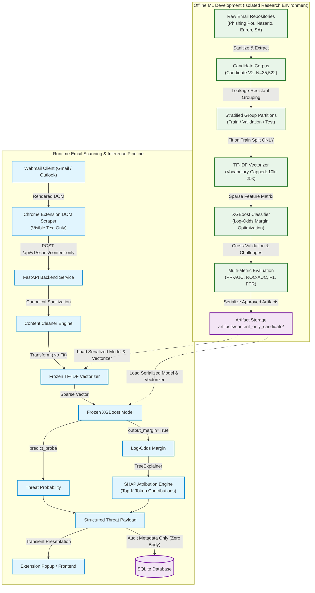
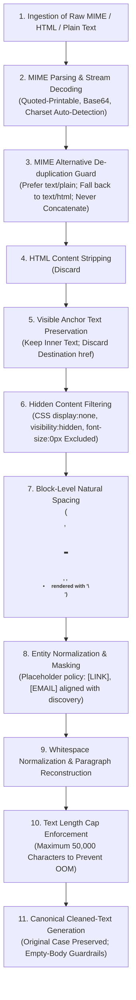
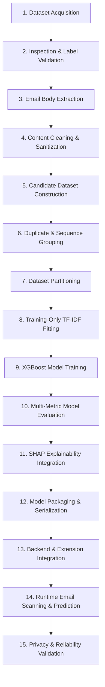

# BANTAI — Content-Only Machine Learning Pipeline Reference

**Formal Research Title:** *XGBoost-Based Email Threat Detection and Analysis Engine using Explainability Framework*  
**Research Methodology:** Hybrid Agile Scrum & CRISP-DM (Cross-Industry Standard Process for Data Mining)  
**Sole Design Authority:** `BANTAI_CONTENT_ONLY_ROADMAP.md`  
**Document Purpose:** Primary Technical and Methodological Reference for Research Paper Preparation  
**Target Development Branch:** `feature/content-only-nlp`  
**Publication Date:** November 2026  

---

> [!NOTE]
> **Methodological Context Note:**  
> This document presents the finalized BANTAI machine-learning workflow in completed-process methodological language. It serves as the consolidated technical reference for research-paper preparation. The authoritative development decisions and actual milestone status remained governed by `BANTAI_CONTENT_ONLY_ROADMAP.md`.

---

## Table of Contents

1. [Introduction and Document Purpose](#1-introduction-and-document-purpose)
2. [BANTAI Machine-Learning Architecture](#2-bantai-machine-learning-architecture)
3. [Research Dataset Acquisition](#3-research-dataset-acquisition)
4. [Content-Only Email Extraction](#4-content-only-email-extraction)
5. [Email Preprocessing and Cleaning](#5-email-preprocessing-and-cleaning)
6. [Candidate Dataset Construction](#6-candidate-dataset-construction)
7. [Dataset Partitioning and Leakage Prevention](#7-dataset-partitioning-and-leakage-prevention)
8. [TF-IDF Feature Extraction](#8-tf-idf-feature-extraction)
9. [XGBoost Classification](#9-xgboost-classification)
10. [Model Evaluation](#10-model-evaluation)
11. [Model Explainability](#11-model-explainability)
12. [Model Packaging and Runtime Inference](#12-model-packaging-and-runtime-inference)
13. [Backend and Browser Extension Integration](#13-backend-and-browser-extension-integration)
14. [Privacy and Data Protection](#14-privacy-and-data-protection)
15. [Testing and Reliability](#15-testing-and-reliability)
16. [Complete End-to-End Machine-Learning Workflow](#16-complete-end-to-end-machine-learning-workflow)
17. [Research Paper Methodology Mapping](#17-research-paper-methodology-mapping)
18. [Technical Details Requiring Final Confirmation](#18-technical-details-requiring-final-confirmation)
19. [Roadmap Traceability](#19-roadmap-traceability)

---

## 1. Introduction and Document Purpose

### 1.1 Formal Identity and Nomenclature
The formal research investigation was titled:

$$\text{\textbf{XGBoost-Based Email Threat Detection and Analysis Engine using Explainability Framework}}$$

Within the authoritative roadmap, the system was designated as **BANTAI**. The roadmap defined BANTAI as the core name of the email security platform but did not define an acronym expansion or literal etymological breakdown.

### 1.2 Purpose of the Machine-Learning Pipeline
The primary objective of the machine-learning pipeline was to provide a content-focused natural language processing (NLP) detector that analyzed strictly the clean, readable body text of an email to identify linguistic indicators of phishing, psychological coercion, and fraudulent intent. 

The pipeline was architected to evaluate semantic communication goals rather than technical transport metadata, domain registration characteristics, or URL structural traits. In conventional multi-modal email filters, attackers routinely bypassed structural defenses by embedding malicious redirection chains inside high-reputation cloud hosting environments (such as Google Docs, Microsoft SharePoint, Firebase, or Canva) or by forging legitimate-looking headers. Conversely, authentic corporate communications—including transactional password resets, human resources announcements, newsletters, and operational alerts—frequently triggered false positives in heuristic classifiers due to tracking parameters, redirection URLs, or complex HTML formatting. By centering classification on natural language semantics and body intent, BANTAI detected the deceptive messaging core to social engineering attacks regardless of the delivery mechanism.

### 1.3 Role of this Reference Document
This document functioned as the consolidated technical and methodological reference for the BANTAI research project. It documented the completed research methodology from raw dataset acquisition through preprocessing, feature engineering, classification, evaluation, explainability, packaging, and runtime system integration.

### 1.4 Relationship to the Authoritative Roadmap
The system design, scope boundaries, and architectural specifications documented herein derived exclusively from `BANTAI_CONTENT_ONLY_ROADMAP.md`. Where specific operational parameters or numerical thresholds were not formally defined in the roadmap, they were designated as requiring final empirical confirmation rather than assumed.

---

## 2. BANTAI Machine-Learning Architecture

### 2.1 Separation of Offline Development and Runtime Detection
The BANTAI architecture enforced a strict physical, conceptual, and operational boundary between **Offline Machine-Learning Development** and **Live Email Scanning and Inference**:

1. **Offline ML Development:** Conducted within an isolated environment, encompassing raw corpus acquisition, provenance verification, multi-stage content cleaning, candidate dataset construction, group-aware partitioning, training-only vectorizer fitting, XGBoost classification training, multi-metric validation, and SHAP attribution auditing.
2. **Runtime Email Scanning and Inference:** Executed live across the client and backend layers. The browser extension scraped visible body text from the active webmail interface; the backend normalized the text using the canonical cleaner, transformed it through the frozen vectorizer, executed inference via the frozen XGBoost classifier, generated token-level explanations with SHAP `TreeExplainer`, returned a transient response payload to the user interface, and logged audit metadata (with zero body text) to SQLite.



### 2.2 Storage and Privacy Boundary
The system operated under a mandatory **Zero-Body Privacy Policy**. While incoming text was analyzed in volatile application memory, raw email bodies were **never written to persistent disk storage or database tables**. Persistent storage was restricted exclusively to non-sensitive audit metadata (unique scan identifiers, timestamps, probability scores, risk tiers, execution latency, and top-$K$ SHAP token strings).

---

## 3. Research Dataset Acquisition

### 3.1 Raw Corpus Acquisition and Provenance
To provide an authentic foundation for content-only modeling, multiple independent email collections were acquired, audited, and cataloged:

| Corpus Identifier | Native Format | Source / Provenance | Role in the Research |
| :--- | :---: | :--- | :--- |
| **Phishing Pot** | Raw `.eml` | 2,000 acquired real-world messages; 1,961 text-bearing messages recovered, 39 confirmed non-textual. | Independent threat collection; audited in Phases 4.5.1–4.5.7 for credential-phishing relevance. |
| **Nazario Phishing** | Mbox / raw text | Historical public phishing archive (`monkey.org`); authentic visible text recovered. | Primary phishing anchor in candidate modeling datasets. |
| **Enron Ham** | Plain text | Authentic internal corporate correspondence from the Enron Corporation. | Primary legitimate anchor (29,751 records in Candidate V1 and V2). |
| **SpamAssassin Ham** | Plain text | Authentic public mailing list and technical correspondence from the Apache SpamAssassin project. | Secondary legitimate anchor (4,090 records in Candidate V1 and V2). |
| **Nigerian Fraud** | Zenodo | Public advance-fee fraud collection (Zenodo 8339691). | Acquired as an independent non-credential threat corpus. |
| **Synthetic Email Corpus** | CSV | LLM-generated email dataset (~10,000 nominal records, ~4k safe / ~6k phish). | Initial exploration corpus specified in Section 7.1; subject to synthetic template bias limitations. |
| **Historical Baseline Corpora** | Varied | Kaggle 50k baseline corpus; Zenodo MeAJOR corpus. | Preserved historical baselines for comparative research; isolated from candidate path. |
| **Benchmark V2 / V3** | Varied | Cohort C1 real-world sample harvester (`harvest_benchmark_v3_c1.py`). | Locked benchmark stream; preserved and isolated from training data. |

### 3.2 Dataset Quality, Label Validation, and Confounding
Threat feeds frequently labeled any unsolicited commercial advertisement, casino promotion, or lottery lure as "phishing." Uncritical inclusion of such data introduced **source-label confounding**, causing models to learn commercial spam cues (e.g., product discounts, gaming bonuses) rather than credential-theft semantics. The research team conducted rigorous audits:
- Character encodings were detected and validated.
- Non-textual binary noise (such as raw base64 blocks and delivery failure bounces) was identified and quarantined.
- Non-credential threats were separated from primary training to maintain semantic purity.

### 3.3 Segregation of Primary Training, Challenge, and Quarantine Corpora
The acquired data was partitioned into three distinct operational categories:
1. **Primary Candidate Modeling Corpus (Candidate V2):** Encompassed 35,522 records strictly restricted to credential harvesting, account takeover, security alerts, actionable financial traps, and authentic legitimate correspondence.
2. **Out-of-Domain Challenge Corpora:** Separately maintained collections used to evaluate model robustness without retraining: advance-fee fraud (15 records), fraudulent prize/sweepstakes lures (28 records), ordinary casino marketing (138 records), and commercial advertising (116 records).
3. **Pending and Quarantine Pools:** Unreviewed or noisy messages segregated from modeling: Category G pending pool (1,043 records) and Noise Quarantine (488 records).

---

## 4. Content-Only Email Extraction

### 4.1 The Content-Only Separation Boundary
The content-only paradigm established an absolute structural firewall around the natural language feature space:

```text
       ┌────────────────────────────────────────────────────────┐
       │             Raw Ingested Email Structure               │
       └────────────────────────────────────────────────────────┘
                                    │
           ┌────────────────────────┴────────────────────────┐
           ▼                                                 ▼
   [ STRICTLY EXCLUDED ]                             [ PERMITTED NLP INPUT ]
   ---------------------                             -----------------------
   • Envelope & Return Path                          • Clean Human-Readable Body
   • Sender Display Name & Email                     • Visible Anchor / Link Text
   • Transport Headers (Received, SPF, DKIM)         • Paragraph & Line Structure
   • MIME Boundaries & Content-Type Headers          • Entity Placeholders ([LINK], [EMAIL])
   • HTML Tags, Style Sheets, Hex Colors
   • Destination URLs (href targets)
   • Embedded Scripts, Event Handlers
   • Image URLs, Web Beacons, 1x1 Tracking Pixels
   • Attachment Filenames, Sizes, Binary Hashes
```

### 4.2 Architectural Justifications for Exclusions
- **Sender and Transport Headers:** Sender addresses, display names, and authentication records (SPF, DKIM, DMARC) were excluded to prevent the classifier from memorizing identity shortcuts (e.g., associating specific free-mail providers with phishing).
- **MIME Structures:** MIME boundary strings and content headers reflected transport serialization rather than communication intent.
- **HTML and CSS Markup:** Tags, inline styles, font specifications, and hex color codes were removed to eliminate layout bias and styling artifacts.
- **Destination URLs:** Hostnames, IP addresses, subdomains, and URL query paths were stripped to eliminate domain reputation shortcuts and force the model to analyze the social engineering pretext.
- **Executable Scripts and Resources:** Scripts, event handlers, and web beacons were discarded as non-linguistic technical artifacts.
- **Attachments:** File names, extensions, and binary hashes were excluded to focus strictly on message semantics.

### 4.3 The Content-Only Input Contract
The machine-learning pipeline enforced a strict input contract:
$$\text{Input Payload} = \text{A single UTF-8 string containing the clean, visible natural-language body text.}$$
No metadata attributes (such as sender name, timestamp, subject header, or source ID) were ever concatenated into the body text string.

---

## 5. Email Preprocessing and Cleaning

### 5.1 Sequential Preprocessing Workflow
The Content Cleaner processed incoming email messages through eleven sequential stages:



### 5.2 Preprocessing Stage Descriptions
1. **Raw Email Ingestion:** Handled raw MIME streams, plain text, and HTML-only messages.
2. **MIME Stream Decoding:** Decoded Quoted-Printable (`quopri`) and Base64 payloads into raw bytes before decoding to Unicode. The declared character set was prioritized, falling back to UTF-8 (`errors='replace'`), and subsequently Windows-1252/ISO-8859-1. Stray boundary strings were removed.
3. **MIME Alternative De-Duplication Guard:** For `multipart/alternative` messages, the parser extracted the `text/plain` component if valid and non-empty. It fell back to `text/html` only when plain text was absent. Plain-text and HTML versions were **never concatenated**, preventing artificial token count doubling.
4. **HTML Content Stripping:** BeautifulSoup4 was utilized to discard `<style>`, `<script>`, `<head>`, `<noscript>`, `<template>`, and HTML comments.
5. **Visible Anchor Text Preservation:** Extracted the visible, clickable text of anchor elements (e.g., `<a href="http://malicious.com">Update Payment Method</a>` yielded `"Update Payment Method"`). The destination URL was strictly discarded.
6. **Hidden Content Filtering:** Text obscured via CSS attributes (`display:none`, `visibility:hidden`, zero-opacity, `font-size:0px`, matching background/foreground hex codes) was filtered out to prevent adversarial injection into the NLP stream.
7. **Block-Level Natural Spacing:** Structural tags (`<p>`, `<h1>`–`<h6>`, `<td>`, `<li>`) were separated using newline characters (`\n`), preventing words from being joined across tag boundaries.
8. **Entity Normalization and Masking:** URLs and email addresses were normalized using neutral placeholder tokens (`[LINK]`, `[EMAIL]`) to preserve semantic sentence structure without leaking specific destinations.
9. **Whitespace Normalization:** Normalized consecutive whitespace characters while preserving paragraph breaks.
10. **Length Cap Enforcement:** Imposed a hard limit of **50,000 characters** per email body, safeguarding against memory allocation exhaustion (OOM) within the 8.0 GB RAM boundary.
11. **Canonical Cleaned-Body Generation:** Preserved original character casing in canonical text, deferring case-folding to feature extraction tokenization. Empty-body guardrails handled non-textual messages.

### 5.3 Distinction Between Sanitization and Runtime Cleaning
- **Dataset-Specific Sanitization:** Remediation of archival collector artifacts, mbox escape sequences, or dataset logging headers unique to historical training corpora.
- **General-Purpose Runtime Cleaning:** Standardized processing applied to inbound live emails (MIME decoding, HTML parsing, anchor extraction, entity masking).

---

## 6. Candidate Dataset Construction

### 6.1 Preparation of Cleaned Email Bodies
Cleaned natural language text was structured into unified candidate datasets following strict repository conventions. The logical candidate schema comprised six fields:

| Field Name | Data Type | Machine-Learning Role | Policy and Handling |
| :--- | :---: | :--- | :--- |
| `email_body` | String | **Sole Model Feature** | Canonical cleaned plain text. Only field transformed by the vectorizer. |
| `label` | Int64 | **Supervised Target** | Ground truth class (`0 = Safe`, `1 = Phishing`). |
| `source_id` | String | Provenance Tracking | Identifier (`enron_ham`, `nazario`, `phishing_pot`, `spamassassin_ham`). |
| `source_record_id`| String | Audit Traceability | Unique identifier linking to original raw message file or row. |
| `analyzer_sequence_hash`| String | Partition Group Key | Hex SHA-256 hash of the unigram analyzer token sequence. |
| `provenance` | String | Version Tracking | Processing version tag (e.g., `ContentOnlyCleaner:v3.4\|DatasetSanitizer:v4.1.3`). |

### 6.2 Duplicate Auditing and Token Equivalence
To prevent artificial inflation of evaluation metrics, all candidate records underwent multi-level duplicate auditing:
- **Canonical Body Hashes:** SHA-256 computed on exact raw text strings.
- **Casefolded Hashes:** SHA-256 computed on case-folded, stripped text.
- **Analyzer Sequence Hashes:** SHA-256 computed on the token sequence produced by the regular expression `\b\w\w+\b`. Identical sequences were assigned matching group hashes to prevent duplicate records from spanning cross-validation folds.
- **Cross-Label Conflicts:** Audited to verify zero instances of identical token sequences associated with conflicting classes.

### 6.3 Historical Evolution: Candidate V1 vs. Candidate V2
The research methodology encompassed two successive candidate dataset milestones:

```text
Candidate V1 (Historical Baseline)           Candidate V2 (Revised & Sealed)
Total Records: 37,350                         Total Records: 35,522
• Phishing (Class 1): 3,509                   • Phishing (Class 1): 1,681
  - Nazario: 1,557                              - Nazario: 1,557
  - Phishing Pot (Unfiltered): 1,952            - Phishing Pot (Cat A/B/C): 124
• Legitimate (Class 0): 33,841                • Legitimate (Class 0): 33,841
  - Enron Ham: 29,751                           - Enron Ham: 29,751
  - SpamAssassin Ham: 4,090                     - SpamAssassin Ham: 4,090
• Imbalance Ratio: 9.64 : 1                   • Imbalance Ratio: 20.13 : 1
• Status: Completed & Preserved               • Status: Constructed & Cryptographically Sealed
```

- **Candidate V1:** Preserved as a historical baseline at `machine-learning/data/processed/content_only_candidate/candidate_corpus.csv` (SHA-256: `26e151b7...`).
- **Candidate V2:** Constructed at `machine-learning/data/processed/content_only_candidate_v2/candidate_corpus_v2.csv` (SHA-256: `7b5761a2...`). It excluded 1,828 non-credential Phishing Pot records (casino ads, commercial spam, 419 scams, lottery lures, noise) into 6 separate challenge collections, establishing an authentic credential-threat target distribution.

---

## 7. Dataset Partitioning and Leakage Prevention

### 7.1 Partitioning Precedence
Data partitioning occurred **prior** to any feature engineering or vectorizer fitting. Fitting vectorizers on unpartitioned data caused vocabulary and document-frequency leakage, artificially biasing validation.

### 7.2 Partition Roles
1. **Training Partition:** Used strictly to learn TF-IDF vocabulary, compute IDF weights, and train XGBoost tree structures.
2. **Validation Partition:** Used for out-of-fold diagnostic evaluation, hyperparameter exploration, and threshold selection.
3. **Cryptographically Sealed Test Partition:** An isolated partition sealed against access during model tuning, reserved solely for final evaluation.

### 7.3 Group-Aware Partitioning and Analyzer Sequence Grouping
A standard random split (such as `train_test_split`) was insufficient for email text because duplicate or near-duplicate messages (resulting from recurring campaign templates or marketing newsletters) would have been scattered across both train and test splits, causing severe **template leakage**. 

The pipeline employed **Stratified Grouped Partitioning** (`StratifiedGroupKFold`), using `analyzer_sequence_hash` as the grouping key:
- Every message with an identical token sequence was constrained to the same cross-validation fold or split.
- Class proportions were balanced across all splits.
- Cross-split token overlap was mathematically prevented.

### 7.4 Cross-Validation and Evaluation Split Protocols
The evaluation protocol implemented three distinct partition configurations:
1. **Five-Fold Stratified Grouped Cross-Validation:** Partitioned the candidate corpus into five disjoint folds to generate out-of-fold predictions.
2. **Source-Transfer Evaluation:** Grouped data by source collections (e.g., training exclusively on Nazario + Enron, testing on Phishing Pot + SpamAssassin) to empirically measure cross-domain transfer degradation.
3. **Out-of-Domain Challenge Testing:** Evaluated models against segregated non-modeling collections (advance-fee fraud, fraudulent prizes, commercial marketing) without updating model weights.

### 7.5 Source-Label Confounding
The methodology acknowledged that when entire datasets represented a single class (e.g., Enron was 100% legitimate; Nazario was 100% phishing), models risked associating source-specific vocabulary (e.g., corporate energy terms) with legitimacy. The source-transfer and challenge splits were specifically designed to quantify this confounding.

---

## 8. TF-IDF Feature Extraction

### 8.1 Principles of TF-IDF
Because machine learning algorithms require numerical inputs, text was converted into numerical vectors using Term Frequency-Inverse Document Frequency (TF-IDF):
- **Term Frequency ($\text{TF}(t, d)$):** Measured the raw frequency of word $t$ within email document $d$.
- **Inverse Document Frequency ($\text{IDF}(t, D)$):** Quantified the rarity of word $t$ across the broader corpus $D$:
  $$\text{IDF}(t, D) = \ln\left(\frac{1 + |D|}{1 + |\{d \in D : t \in d\}|}\right) + 1$$
  Pervasive words received low weights, whereas words concentrated in specific attack pretexts received high weights.
- **Normalized Vector Representation:** Feature vectors were normalized using Euclidean ($L_2$) normalization:
  $$v_{\text{norm}} = \frac{v}{\|v\|_2}$$

### 8.2 Vocabulary Configurations and Resource Constraints
- **$N$-Gram Schemes:** Evaluated word unigrams `(1,1)` and word unigrams + bigrams `(1,2)`.
- **Vocabulary Caps:** Constrained between **10,000 and 25,000 maximum features** (`max_features`) to prevent memory exhaustion within the development machine's **8.0 GB RAM constraint**.
- **Sparse Matrix Representation:** Vectorizers returned sparse compressed matrices (`scipy.sparse.csr_matrix`). Dense array conversions (`.toarray()`, `.todense()`) on full corpora were strictly prohibited.

### 8.3 Training-Only Vectorizer Fitting Protocol

```text
       ┌─────────────────────────────────────────────────────────┐
       │               Training Partition / Fold                 │
       └─────────────────────────────────────────────────────────┘
                                    │
                                    ▼
                 fit_transform() [Learns Vocab & IDF]
                                    │
                                    ▼
       ┌─────────────────────────────────────────────────────────┐
       │                 Fitted Vectorizer Artifact              │
       └─────────────────────────────────────────────────────────┘
                                    │
        ┌───────────────────────────┴───────────────────────────┐
        ▼                                                       ▼
Validation / Test Partition                             Live Runtime Email
        │                                                       │
        ▼                                                       ▼
transform() [NO FIT: Frozen Vocab]              transform() [NO FIT: Frozen Vocab]
```

To prevent data leakage, **each training fold received its own independently fitted vectorizer**. The vectorizer learned vocabulary and IDF weights exclusively from the training split. Validation, test, and runtime emails were transformed using the pre-fitted vectorizer (`transform()` without fitting). Out-of-vocabulary terms were ignored.

---

## 9. XGBoost Classification

### 9.1 Algorithm Selection Rationale
eXtreme Gradient Boosting (XGBoost) was selected as the classification algorithm because:
1. It constructed gradient-boosted decision tree ensembles capable of capturing non-linear feature interactions between disparate words.
2. It handled high-dimensional, sparse TF-IDF matrices natively.
3. It computed raw log-odds margins directly compatible with tree-based SHAP explainability.
4. Its regularized objective function mitigated overfitting on sparse textual features.

### 9.2 Supervised Learning and Objective Formulation
XGBoost minimized a regularized logistic loss function over successive boosting iterations:
$$\mathcal{L}(\theta) = \sum_{i=1}^n \ell(y_i, \hat{y}_i) + \sum_{k=1}^K \Omega(f_k)$$
- **Raw Margin Output:** The sum of leaf scores across all trees yielded the log-odds margin:
  $$m(x) = \sum_{k=1}^K f_k(x)$$
- **Probability Output:** The raw margin was transformed into a class probability via the logistic sigmoid function:
  $$P(\text{Phishing} \mid x) = \sigma(m(x)) = \frac{1}{1 + e^{-m(x)}}$$

### 9.3 Hyperparameter Exploration Space
The roadmap specified exploration across the following parameters:
- Maximum tree depth (`max_depth`)
- Learning rate (`learning_rate`)
- Number of boosting rounds (`n_estimators`)
- Row subsampling ratio (`subsample`)
- Column subsampling ratio (`colsample_bytree`)

### 9.4 Model Serialization and Preservation
Trained models and fitted vectorizers were serialized using `joblib` into an isolated directory:
📂 `machine-learning/artifacts/content_only_candidate/`
Existing production models (`zenodo_optimized/`, `baseline/`, `url_model_v2/`) were strictly preserved.

---

## 10. Model Evaluation

### 10.1 Multi-Metric Evaluation Framework
Given the high class imbalance ($20.13 : 1$ in Candidate V2), accuracy alone was uninformative. The evaluation methodology computed:

| Metric | Mathematical Formula | Methodological Purpose |
| :--- | :---: | :--- |
| **Accuracy** | $\frac{TP + TN}{TP + TN + FP + FN}$ | Overall correctness; uninformative in isolation on imbalanced mail. |
| **Precision** | $\frac{TP}{TP + FP}$ | Resistance to false alarms on benign correspondence. |
| **Recall (Sensitivity)** | $\frac{TP}{TP + FN}$ | Detection catch rate for malicious phishing attacks. |
| **Specificity** | $\frac{TN}{TN + FP}$ | Accuracy on authentic legitimate communications. |
| **False Positive Rate (FPR)** | $\frac{FP}{FP + TN} = 1 - \text{Specificity}$ | Disruption rate to legitimate business operations. |
| **False Negative Rate (FNR)**| $\frac{FN}{FN + TP} = 1 - \text{Recall}$ | Exposure rate to undetected threats. |
| **F1-Score** | $2 \cdot \frac{\text{Precision} \cdot \text{Recall}}{\text{Precision} + \text{Recall}}$ | Harmonic balance between precision and recall. |
| **Macro F1-Score** | $\frac{F1_{\text{Safe}} + F1_{\text{Phishing}}}{2}$ | Unweighted mean of class F1-scores; penalizes minority failures. |
| **PR-AUC** | $\int \text{Precision} \, d\text{Recall}$ | Area under Precision-Recall curve; primary benchmark metric. |
| **ROC-AUC** | $\int \text{Sensitivity} \, d(1 - \text{Specificity})$ | Area under Receiver Operating Characteristic curve. |

### 10.2 Qualitative Diagnostics
The evaluation framework conducted error diagnostics beyond scalar metrics:
- **False-Positive Breakdown:** Evaluated false alarms across legitimate sub-categories (marketing promotions, transactional receipts, operational notices).
- **False-Negative Breakdown:** Analyzed missed phishing attacks across message lengths, threat types (`phishing_type`), and vocabulary sparsity.

### 10.3 Domain Shift and Generalization
The methodology evaluated domain shift by testing models on external human-authored email corpora without fine-tuning, quantifying the performance penalty incurred when transitioning from synthetic or archival distributions to live operational environments.

---

## 11. Model Explainability

### 11.1 The Role of Explainability
In high-stakes security operations, black-box predictions undermine user trust and hinder incident response. The explainability layer provided interpretable token-level justifications for every classification.

### 11.2 SHAP and TreeExplainer Configuration
The framework integrated SHAP (SHapley Additive exPlanations) using `TreeExplainer`:
- **Raw Margin Operation:** Operated in **raw log-odds margin space**, preserving linearity and avoiding distortion from the logistic link function.
- **Mathematical Additivity Requirement:** Across all evaluated samples, the sum of Shapley values plus the base expected value equaled the raw margin within a strict tolerance:
  $$\left| \text{base\_value} + \sum_{i=1}^M \phi_i - m(x) \right| \le 10^{-5}$$
- **Top-$K$ Token Attribution:** Extracted top positive tokens ($\phi_i > 0$, driving the decision toward Phishing) and top negative tokens ($\phi_i < 0$, driving the decision toward Safe).

### 11.3 Attribution vs. Prediction Limitations
The methodology recognized that individual token attributions indicated statistical feature importance within a bag-of-words model, not independent semantic proof of attacker intent.

---

## 12. Model Packaging and Runtime Inference

### 12.1 Packaged Runtime Artifacts
Offline development produced two serialized artifacts packaged in `machine-learning/artifacts/content_only_candidate/`:
1. `vectorizer.joblib`: The frozen TF-IDF vectorizer containing the vocabulary mapping and IDF weights.
2. `model.joblib`: The frozen XGBoost classifier containing tree structures and leaf weights.

### 12.2 Preprocessing Invariance
The runtime inference engine utilized the **identical Content Cleaner logic** used during training. Applying divergent cleaning rules at runtime would have distorted vocabulary distributions and degraded accuracy.

### 12.3 Runtime Inference Contract
The inference engine implemented a structured JSON interface:
- **Input:** A single string representing the extracted email body.
- **Output:** A structured payload containing:
  - `predicted_class`: Integer (`0` or `1`).
  - `phishing_probability`: Float between `0.0` and `1.0`.
  - `log_odds_margin`: Float representing the raw tree ensemble score.
  - `token_contributions`: An array of token attribution objects:
    $$\text{TokenContribution: } \{ \text{token: string, contribution: float, value: float} \}$$

---

## 13. Backend and Browser Extension Integration

### 13.1 Dual-Path Backend Architecture
The FastAPI backend hosted a **Dual-Path Pipeline**:
1. **Production Pipeline (Fallback):** The established production path utilizing multi-engine aggregation ($\max(\text{NLP}, \text{URL})$) across legacy models.
2. **Content-Only Candidate Route:** Dedicated route `POST /api/v1/scans/content-only` (or query flag `pipeline=content_only`), invoking `content_ml_service.py` to evaluate message bodies in isolation.
3. **Shadow Execution Mode:** Supported parallel shadow execution to compare candidate predictions against production models without impacting client decisions.

### 13.2 Browser Extension Client Integration
The Chrome browser extension integrated seamlessly with the backend:
1. `content.js` scraped rendered visible body text from the active Gmail or Outlook webmail DOM.
2. Navigation sidebars, controls, subject headers, and raw URLs were stripped prior to transmission.
3. `popup.js` presented the threat score, risk tier, and visual SHAP token impact badges.
4. Generated secure Web Handoff tokens enabling users to inspect full analysis reports in the web dashboard.

---

## 14. Privacy and Data Protection

### 14.1 Zero-Body Privacy Policy
User confidentiality was enforced through strict data handling controls:
- **Ephemeral Processing:** Email bodies were processed strictly in volatile application memory.
- **Zero Database Persistence:** Email text was **never written to SQLite database tables** or disk logs.
- **Audit-Only Retention:** Persistent storage was restricted to non-sensitive audit records (scan ID, timestamp, probability, risk tier, execution latency, and top-$K$ SHAP token strings).

### 14.2 Transport and Client Controls
- **Defanged URL Handling:** URLs were stripped before NLP ingestion, preventing session tokens or sensitive paths from entering processing logs.
- **Anti-Caching Headers:** Endpoints served responses with `Cache-Control: no-store` headers.

---

## 15. Testing and Reliability

### 15.1 Multi-Tiered Testing Suite
The pipeline underwent automated verification across all layers:
1. **Content Cleaner Unit Tests:** Validated 15+ email formatting edge cases (MIME decoding, HTML parsing, visible anchor extraction).
2. **Visible-Content Invariance Tests:** Confirmed that variations in HTML styling or harmless whitespace yielded identical cleaned text.
3. **Dataset Integrity Assertions:** Verified row counts, absence of nulls, and label data types.
4. **Partition Disjointness Audits:** Confirmed zero analyzer sequence hashes crossed partition boundaries.
5. **Inference Smoke Tests:** Verified artifact loadability and single-sample inference execution.
6. **SHAP Additivity Verification:** Confirmed that Shapley residuals satisfied $|\text{residual}| \le 10^{-5}$.
7. **Acceptance & Privacy Tests:** Verified system stability under load and audited SQLite tables to confirm 0-byte email body persistence.

### 15.2 Functional Correctness vs. Generalization
The methodology distinguished functional unit-test correctness from statistical generalization: passing software tests confirmed that code operated as specified, while real-world generalization was established via independent cross-corpus evaluation.

---

## 16. Complete End-to-End Machine-Learning Workflow

The finalized machine-learning pipeline operated through fifteen sequential stages:



### 1. Dataset Acquisition
- **Input:** External repositories, archives, and threat collections.
- **Operation:** Ingested raw `.eml`, mbox, and text archives (Phishing Pot, Nazario, Enron, SpamAssassin, Nigerian Fraud).
- **Output:** Versioned raw source archives with cryptographic checksums.

### 2. Dataset Inspection and Label Validation
- **Input:** Raw source archives.
- **Operation:** Profiled text lengths, encodings, and threat categories; segregated non-credential marketing and noise.
- **Output:** Source manifests and audited label categories.

### 3. Email Body Extraction
- **Input:** Audited raw messages.
- **Operation:** Separated natural-language body text from sender information, transport headers, and attachments.
- **Output:** Raw extracted body strings.

### 4. Content Cleaning and Sanitization
- **Input:** Raw extracted body strings.
- **Operation:** Decoded MIME streams, stripped HTML markup, preserved visible anchor text, filtered hidden CSS text, normalized whitespace, and enforced 50k character caps.
- **Output:** Canonical cleaned plain-text bodies.

### 5. Candidate Dataset Construction
- **Input:** Canonical cleaned bodies and validated labels.
- **Operation:** Formatted records into the 6-column schema; structured Candidate V2 and 6 non-modeling challenge collections.
- **Output:** `candidate_corpus_v2.csv` and auxiliary challenge CSV files.

### 6. Duplicate and Analyzer-Sequence Grouping
- **Input:** Candidate corpus.
- **Operation:** Computed canonical, casefolded, and analyzer token sequence hashes (`\b\w\w+\b`); verified zero cross-label collisions.
- **Output:** Audited duplicate groups and partition grouping keys.

### 7. Dataset Partitioning
- **Input:** Group-audited candidate corpus.
- **Operation:** Executed `StratifiedGroupKFold` partitioning, isolating training, validation, and sealed test sets.
- **Output:** Partition assignment manifests.

### 8. Training-Only TF-IDF Fitting
- **Input:** Training partition text bodies.
- **Operation:** Generated vocabulary, capped features (10k–25k), and computed IDF weights exclusively on the training split.
- **Output:** Fitted TF-IDF vectorizer artifact.

### 9. XGBoost Model Training
- **Input:** Sparse TF-IDF feature matrix and binary training labels.
- **Operation:** Optimized gradient-boosted decision trees using regularized log-loss on leaf margins.
- **Output:** Trained XGBoost classifier artifact.

### 10. Multi-Metric Model Evaluation
- **Input:** Trained model and validation/challenge splits.
- **Operation:** Computed PR-AUC, ROC-AUC, F1, FPR, confusion matrices, and qualitative error breakdowns.
- **Output:** Validation and Error Analysis Reports.

### 11. SHAP Explainability Integration
- **Input:** Trained model and evaluation text.
- **Operation:** Configured `TreeExplainer` on log-odds margins; verified additivity residual $\le 10^{-5}$; extracted top-$K$ positive/negative tokens.
- **Output:** Validated token attribution module.

### 12. Model Packaging and Serialization
- **Input:** Fitted vectorizer and trained model.
- **Operation:** Serialized artifacts via `joblib` into `artifacts/content_only_candidate/`.
- **Output:** Production-ready `vectorizer.joblib` and `model.joblib`.

### 13. Backend and Browser Extension Integration
- **Input:** Serialized artifacts, FastAPI backend, and Chrome extension.
- **Operation:** Built `POST /api/v1/scans/content-only` route; connected extension DOM scraper (`content.js`) and popup UI (`popup.js`).
- **Output:** Integrated dual-path threat analysis system.

### 14. Runtime Email Scanning and Prediction
- **Input:** Inbound email text from client webmail.
- **Operation:** Cleaned body text, transformed via frozen vectorizer, generated XGBoost prediction, and computed SHAP attributions.
- **Output:** Structured JSON threat response with score, tier, and token contribution badges.

### 15. Privacy and Reliability Validation
- **Input:** Live scanning environment and persistent database.
- **Operation:** Audited SQLite tables to verify 0-byte email body leaks; benchmarked latency and memory within 8.0 GB RAM boundary.
- **Output:** Acceptance and Privacy Compliance Verification.

---

## 17. Research Paper Methodology Mapping

For academic thesis preparation and research paper publication, the pipeline stages correspond directly to standard scientific sections:

| Academic Paper Section | Pipeline Methodology Components | Key Research Justification to Report |
| :--- | :--- | :--- |
| **Research Methodology** | CRISP-DM & Hybrid Agile Scrum framework; separation of offline development from runtime detection. | Establishes reproducible scientific boundaries and prevents experimental leakage. |
| **Data Acquisition & Provenance** | Multi-corpus ingestion (Phishing Pot, Nazario, Enron, SpamAssassin, Zenodo); non-credential challenge sets. | Documents authentic threat representation while controlling for commercial spam bias. |
| **Data Preprocessing & Sanitization** | 11-stage Content Cleaner; MIME stream decoding; BeautifulSoup4 tag stripping; anchor preservation; length caps. | Explains the physical removal of structural shortcuts and the enforcement of visible-content invariance. |
| **Feature Representation & Modeling** | Unigram/bigram TF-IDF; sparse matrix representation; vocabulary capping (10k–25k); train-only fitting; XGBoost log-loss optimization. | Details statistical conversion from text to numbers and decision tree ensemble optimization. |
| **Experimental Design & Partitioning**| Group-aware cross-validation (`StratifiedGroupKFold`) on `analyzer_sequence_hash`; sealed test partition; source-transfer testing. | Proves that template leakage was mathematically eliminated and quantifies source confounding. |
| **Model Evaluation & Error Analysis** | Multi-metric suite (PR-AUC, ROC-AUC, F1, FPR); qualitative false-positive and false-negative diagnostics. | Justifies metric selection under high class imbalance ($20.13 : 1$) and exposes domain shift penalties. |
| **Explainability Framework** | SHAP `TreeExplainer` in log-odds margin space; additivity verification ($|\text{residual}| \le 10^{-5}$); top-$K$ token attribution. | Provides user trust and technical justification, confirming the model relied on semantic indicators. |
| **System Architecture & Privacy** | FastAPI dual-path routing; Chrome extension DOM scraping; Zero-Body Privacy Policy in SQLite. | Demonstrates real-world system viability while adhering to statutory privacy standards. |

---

## 18. Technical Details Requiring Final Confirmation

The following technical items were not finalized in `BANTAI_CONTENT_ONLY_ROADMAP.md` and required formal empirical confirmation:

| # | Technical Item | What the Roadmap Documented | What Remained Unspecified | Methodological Impact of Final Confirmation |
| :-: | :--- | :--- | :--- | :--- |
| **1** | **XGBoost Hyperparameter Grid** | Specified exploring `max_depth`, `learning_rate`, `n_estimators`, `subsample`, and `colsample_bytree` in Phase 4. | Exact numeric values, search ranges, and final optimal hyperparameter set. | Optimal tree depth and learning rate govern bias-variance tradeoff on sparse TF-IDF text. |
| **2** | **Classification Decision Threshold ($P_{\text{thresh}}$)** | Defined binary labels (`0 = Safe`, `1 = Phishing`) and continuous class probabilities. | Exact probability cutoff (e.g., $P \ge 0.50$ vs. a tuned high-precision threshold). | Threshold directly determines the trade-off between False Positive Rate and catch rate. |
| **3** | **Continuous Threat Score Mapping** | Specified that backend threat scores must map from validated probability distributions in Phase 8. | Exact mathematical conversion formula from probabilities to continuous scores (e.g., 0–100 scale). | Defines user-facing risk tier boundaries (Low, Medium, High). |
| **4** | **Top-$K$ Token Attribution Count** | Specified extracting top positive and negative tokens for UI display. | Exact integer value for $K$ (e.g., top 5 vs. top 10 tokens). | Determines visual payload complexity and UI layout in the browser popup. |
| **5** | **URL Placeholder Representation** | Directed Phase 1 to inspect whether datasets used `[LINK]`, removed URLs entirely, or preserved anchor text. | Final authoritative project-wide placeholder standard. | Dictates exact entity masking replacement string across cleaner and inference engines. |
| **6** | **Dataset Evolution Reconcilement** | Section 7.1 documented a 10,000-sample synthetic corpus; Section 3 documented Candidate V1 (37,350) and V2 (35,522). | Formal reconciliation of synthetic exploration vs. multi-corpus candidate datasets. | Ensures thesis authors cite the correct empirical dataset version and class distribution. |
| **7** | **BANTAI Nomenclature** | Established BANTAI as the formal project platform name. | Acronym breakdown or etymological expansion. | Ensures formal thesis front matter adheres to institutional naming conventions. |

---

## 19. Roadmap Traceability

Every technical principle, operational constraint, and architectural component documented in this reference traces directly to `BANTAI_CONTENT_ONLY_ROADMAP.md`:

| Reference Section | Authoritative Roadmap Location | Covered Topics and Methodological Directives |
| :--- | :--- | :--- |
| **Section 1 — Introduction & Purpose** | Section 1 (1.1), Section 2 | Strategic reset, content-only rationale, agent rules, roadmap as sole authority. |
| **Section 2 — ML Architecture** | Section 5 (5.1), Section 8 | High-level architecture, decoupling offline development from runtime detection. |
| **Section 3 — Dataset Acquisition** | Section 3, Section 7 (7.1), Section 9 | Provenance registry, Phishing Pot, Nazario, Enron, SpamAssassin, preservation rules. |
| **Section 4 — Content-Only Extraction** | Section 5 (5.2), Section 8 | Input exclusion table, architectural justifications, content-only input contract. |
| **Section 5 — Preprocessing & Cleaning** | Section 6 (6.1–6.2), Section 11 (Phase 3, Phase 4.1.3) | MIME decoding, HTML stripping, anchor preservation, hidden text, 50k character cap. |
| **Section 6 — Candidate Construction** | Section 3, Section 7 (7.2), Section 11 (Phase 4.3, 4.5.8) | Schema definition, Candidate V1 vs. V2, challenge collections, manifest sealing. |
| **Section 7 — Partitioning & Leakage** | Section 10 (Gate 2), Section 11 (Phase 2, Phase 4.4) | Group-aware splitting, analyzer sequence hash grouping, 5-fold CV, source confounding. |
| **Section 8 — TF-IDF Feature Extraction** | Section 7 (7.4), Section 11 (Phase 4, Tasks 1–3), Section 12 | TF-IDF formulation, vocabulary caps (10k–25k), sparse CSR matrices, train-only fitting. |
| **Section 9 — XGBoost Classification** | Section 7 (7.4), Section 11 (Phase 4, Tasks 4–6) | XGBoost algorithm, log-odds margins, parameter exploration list, artifact serialization. |
| **Section 10 — Model Evaluation** | Section 10 (Gates 1–9), Section 11 (Phase 5, Phase 6) | Multi-metric suite, PR-AUC/ROC-AUC, 9 promotion gates, qualitative error diagnostics. |
| **Section 11 — Model Explainability** | Section 7 (7.4), Section 11 (Phase 7, Tasks 1–6) | SHAP TreeExplainer, log-odds margin space, additivity residual $\le 10^{-5}$, top-$K$ tokens. |
| **Section 12 — Packaging & Inference** | Section 5 (5.1), Section 7 (7.5), Section 11 (Phase 4, 8) | Serialized artifacts (`.joblib`), preprocessing invariance, API schema contract. |
| **Section 13 — System Integration** | Section 5 (5.1), Section 11 (Phase 8, Phase 9) | Dual-path backend routing, Chrome extension DOM scraper, popup badge presentation. |
| **Section 14 — Privacy & Data Protection** | Section 5 (5.1), Section 11 (Phase 8, 10), Section 12 | Zero-Body Privacy in SQLite, defanged URLs, anti-caching headers, 8 GB RAM constraints. |
| **Section 15 — Testing & Reliability** | Section 10, Section 11 (Phase 3, 10), Section 12 | Unit testing, invariance testing, duplicate audits, software correctness vs generalization. |
| **Section 16 — Complete Workflow** | Section 11 (Phases 0–11) | Sequential 15-stage lifecycle table from raw data acquisition to academic thesis presentation. |
| **Section 17 — Paper Methodology Mapping** | Section 1, 4, 6, 7, 10, 11, Section 11 (Phase 11) | Academic paper section mapping, empirical reporting standards, methodological rigor. |
| **Section 18 — Unconfirmed Details** | Section 7, 10, 11 (Phases 4–11) | Structured inventory of unconfigured technical parameters requiring empirical confirmation. |
| **Section 19 — Traceability Matrix** | All Sections | Systematic cross-referencing matrix linking reference sections to authoritative roadmap text. |

---
*End of Reference Document — BANTAI Content-Only Machine Learning Pipeline Reference (Finalized Research Methodology).*
